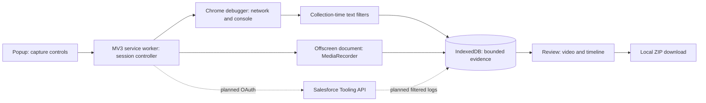

# Architecture review

Update for version 0.4.0: browser-session detection and cookie permission have been removed. The configured External Client App OAuth connection is mandatory for full Salesforce diagnostics. Browser video, network/HAR metadata, console errors, environment snapshot, and timeline need no Salesforce connection. Identity and authenticated REST API checks verify token validity; the capture tab must match the connected My Domain. The popup rechecks on opening, periodically while open, and on request, and capture performs a fresh check. Tokens remain in session-only storage. Apex capture is integrated as of 0.5.0.

Update for version 0.2.0: the optional PKCE connection described below is now implemented in `auth-controller.js` and `core/oauth.js`, with session-only tokens, exact-domain optional permissions, identity verification, and disconnect/revocation. The following capture-to-Tooling pipeline remains planned. Live-org authentication has not yet been verified. See [Salesforce setup](SALESFORCE_SETUP.md).

## Recommendation

Use a browser-first, local-only extension for the MVP. Keep recording, evidence, and export on the device. Add Salesforce authorization as a separate optional capability. A backend becomes necessary only if customer policy requires confidential OAuth credentials, a privileged support-side log collector, shared case storage, or remote submission.

The first meaningful increment is browser capture and review. Do not make end users obtain administrative permissions to produce useful browser evidence.

## Runtime responsibilities

| Component | Responsibility | Constraints |
| --- | --- | --- |
| Popup | Explicit start action, stop/review | Popup closure must not stop the recorder |
| Service worker | Single-session state machine, debugger attachment, event normalization | No DOM or MediaRecorder; serialize mutations; recover persisted state |
| Offscreen document | Consume tab stream ID, record WebM chunks | Only runtime extension API; exchange messages with controller |
| IndexedDB | Store filtered evidence and video chunks | Storage failures stop capture; keep only latest session |
| Review page | Preview, seek, summarize omissions, opt in to video, export | Render evidence using textContent, never injected HTML |
| Tooling adapter | Authorized trace/log operations | Separate OAuth identity; browser session does not grant API access |

Chrome supports the service-worker-to-offscreen stream-ID approach from Chrome 116. This prototype targets Chrome 118 because an active debugger session also keeps the worker alive from that version. A restarted browser cannot resume recording. [Screen capture documentation](https://developer.chrome.com/docs/extensions/how-to/web-platform/screen-capture), [service worker lifecycle](https://developer.chrome.com/docs/extensions/develop/concepts/service-workers/lifecycle).

The debugger API provides Network and Runtime events. It needs an explicit debugger permission, can be blocked by enterprise policies, and capture ends when attachment is lost. Ordinary webRequest metadata cannot replace full debugger-based evidence, especially if response bodies are added later. Chrome 125 flat debugger sessions enable wider iframe coverage; that is a later increment. [Debugger documentation](https://developer.chrome.com/docs/extensions/reference/api/debugger).

## Session and timing model

`starting → recording → stopping → ready`, with `error` on startup failure. Start reserves a single session, obtains a tab stream, attaches the debugger, enables domains, and starts the recorder. Stop detaches first, waits for final recording chunks, and opens review. Failed startup rolls back recording and debugger attachment.

Evidence uses UTC epoch milliseconds and offsets from `startedMs`. Network events map CDP monotonic time to epoch time using each request's `wallTime` and `timestamp`. Runtime console/exception events already carry epoch milliseconds. The video has its own `videoStartedMs`; seek subtracts that clock from the event timestamp. Browser and video timing is approximate, not frame-accurate.

The session ID is saved in session/local extension storage and evidence in IndexedDB. Worker re-entry loads persisted data. Browser restart marks an active previous session interrupted. Repeated controller crashes during `starting` or `stopping`, extension reload mid-recording, high-volume event queue backpressure, and offscreen disappearance need additional recovery validation before pilot.

Server logs must later preserve Salesforce StartTime, retrieval time, and a clock-offset estimate. Correlation should be labeled temporal unless a reliable request identifier is available; never imply a browser request caused a specific Apex log purely from proximity.

## Salesforce authentication and authorization

Configure a Salesforce External Client App or an existing appropriate Connected App. Prefer authorization code flow with PKCE for the extension as a public client. Register a stable extension redirect URL, validate state, retain the PKCE verifier only during login, and request the API scope. Never embed a client secret or copy session cookies. If the org requires a client secret, move token exchange to a managed confidential backend. [Salesforce OAuth overview](https://developer.salesforce.com/docs/platform/api-rest/guide/intro-oauth-and-connected-apps.html), [web server flow](https://help.salesforce.com/s/articleView?id=sf.remoteaccess_oauth_web_server_flow.htm&language=en_US&type=5).

Chrome identity and optional Salesforce host permissions are implemented. Connect requests known exact login, expected My Domain, and standard identity hosts during the initiating user gesture. OAuth then verifies identity and API access automatically when the returned origins are covered. An unexpected returned host uses the fallback org-access action. Pending connections also verify automatically on validation once the required access is present. Instance and identity URL validation are implemented. A verified External Client App connection is required before full diagnostic capture. Browser-only capture skips Salesforce API access, while still using the debugger for network and console evidence. The canonical My Domain must match the capture tab; identity and authenticated REST access are checked live. REST version 67.0 is currently used; dynamic API version negotiation is pending. GovCloud and custom Experience Cloud domains require separate tested origin policy; the current OAuth and Tooling transports support `.salesforce.com` only.

OAuth authorization does not add Salesforce privileges. API access, app policies, org edition, permission sets, and debug-log privileges all affect coverage. Salesforce documents View All Data for viewing, retaining, and deleting debug logs. Validate actual TraceFlag/DebugLevel/ApexLog operations in each pilot org, and distinguish 401, 403, quota exhaustion, expired traces, and genuinely empty log windows in the UI. [Debug Logs permissions](https://help.salesforce.com/s/articleView?id=code_debug_log.htm&language=en_US&type=5).

For a low-privilege end user, browser capture remains useful when Apex access is unavailable. A support engineer can authorize a permitted identity in a later integration. A remote support engineer cannot acquire the end user's local tab through the support engineer view; privileged remote collection needs a separate pairing/backend design and customer approval.

Before reproduction, create a short-lived user TraceFlag with an existing admin-approved DebugLevel. Detect existing overlapping flags and avoid modifying them. After reproduction, poll a bounded log window to account for delayed logs, fetch permitted bodies, filter them, and persist capture coverage. Delete only flags created by this diagnostic session in a finally path. Persist ownership for retries; expiration is the fallback when cleanup fails. The capture service implements bounded polling and redacted ZIP export. Token-free ownership records persist in local extension storage; cleanup checks the remote trace identity before deletion and retries for the matching app account. [TraceFlag](https://developer.salesforce.com/docs/atlas.en-us.api_tooling.meta/api_tooling/tooling_api_objects_traceflag.htm), [ApexLog](https://developer.salesforce.com/docs/atlas.en-us.api_tooling.meta/api_tooling/tooling_api_objects_apexlog.htm).

## Data minimization and export

This increment deliberately collects network metadata, not bodies. Filter before persistence: remove URL credentials/fragments and all query values; mask Salesforce-looking path IDs; retain only a small header allowlist. Text filters cover common emails and credential patterns but cannot guarantee removal of sensitive application content. No raw CDP events are stored.

Do not describe the recording as redacted. The review UI excludes it from ZIP by default and labels it unredacted. Later video masking needs a capture/compositing design, coverage tests across navigation and scrolling, and a reliable preview; CSS overlays alone are insufficient assurance.

ZIP layout: `summary.json`, `environment.json`, `timeline.json`, `network.har`, `README.txt`, and optional `recording.webm`. `apex/*.log` files declare truncation and missing logs through the summary. Preserve schema versions and collection coverage so support knows what was omitted.

No export automatically submits a case. Keep Salesforce Case creation and other external writes outside this MVP until authentication, destinations, and user approval are designed.
